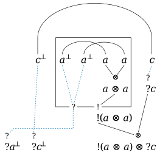

# Export a proof

`prove` and `check` write the proof in the format `--format` names:
- `text`, the default: the verdict line, then the derivation as a text
  tree;
- `latex` or `typst`: a proof tree to paste into a paper or slides;
- `svg`, `png` or `pdf`: a drawing of the derivation, or with `--net`
  of its proof net;
- `rocq`: a certificate that Rocq checks;
- `json`: for `prove` the whole outcome, which `check` reads back.

`--output FILE` writes to a file, in the format its extension names
(`.txt`, `.json`, `.tex`, `.typ`, `.svg`, `.png`, `.pdf` or `.v`).
`--format` overrides the extension, and `--format tex` is read as
`latex`. `--standalone` writes a document that compiles on its own
(LaTeX, Typst and Rocq) in place of a fragment to paste.

```console
$ deduxit prove -i --output proof.pdf "1, A & B, B -o C |- C"
provable (IMALL, intuitionistic, two-sided engine)
```

A file is made only when it holds a derivation or a net, or in JSON,
which is always written. For an unprovable sequent the verdict goes to
standard error and no file is made; the exit status gives the verdict.
An SVG on standard output is likewise a drawing or nothing.
`--no-verdict` leaves out the verdict line.

A program calls `export::latex::to_string(&derivation, &options)`, or
the same function of `typst`, `svg` or `rocq`, for the export as one
string; each format's `write` writes into any `fmt::Write` and asks a
stop between inferences ([Use the library](library.md)).

## LaTeX and Typst

`--format latex` writes the derivation as a proof tree for the
[ebproof](https://ctan.org/pkg/ebproof) package, with the connectives
of [cmll](https://ctan.org/pkg/cmll) and amssymb. Two-sided trees align
their turnstiles. `--format typst` writes it for the
[curryst](https://typst.app/universe/package/curryst) package. The
verdict line becomes a comment. `seq print` takes the same formats for
a sequent:

```console
$ deduxit prove -i --format latex "A, A -o B |- B"
% provable (IMLL, intuitionistic, two-sided engine)
\begin{prooftree}
\infer0[$\mathrm{ax}$]{A &\vdash A}
\infer0[$\mathrm{ax}$]{B &\vdash B}
\infer2[$\multimap\mathrm{L}$]{A, A \multimap B &\vdash B}
\end{prooftree}
$ deduxit prove --format typst "A & B |- A + B"
// provable (ALL, classical, additive engine)
#prooftree(
  rule(
    name: $⊕_1$,
    rule(
      name: $⊕_1$,
      rule(name: $"ax"$, $⊢ A^⊥, A$),
      $⊢ A^⊥, A ⊕ B$,
    ),
    $⊢ A^⊥ ⊕ B^⊥, A ⊕ B$,
  ),
)
$ deduxit seq print -i --format latex "A * B -o C |- A -o B -o C"
$(A \otimes B) \multimap C \vdash A \multimap (B \multimap C)$
$ deduxit seq print --format typst "A * B -o C |- A -o B -o C"
$⊢ (A ⊗ B) ⊗ C^⊥, A^⊥ ⅋ (B^⊥ ⅋ C)$
```

`--standalone` writes a document that compiles on its own, cropped to
the tree. `pdflatex` needs the ebproof, cmll, amsfonts and standalone
packages, and `typst compile` fetches curryst 0.6.0 on first use:

```console
$ deduxit prove --format latex --standalone --output proof.tex "!A |- A * !A"
$ pdflatex proof.tex
```

Neither form chooses a font: the output takes the fonts of the document
it goes into. Names of more than one letter are set in italics
(`\mathit{foo}`, `italic("foo")`), and the characters LaTeX or Typst
treat specially are escaped. LaTeX writes Greek letters as their
commands (`\alpha`), and the `‿` and `·` of the names read from the
LLTP library as `\smallsmile` and `\cdotp`, so that pdfLaTeX compiles
them.

### High trees in Typst

Typst refuses a curryst tree with binary rules more than nine
inferences high. deduxit writes a higher tree in a layout of its own: a
`#context` block that lists the inferences, and the Typst code that
measures and places them. It needs no package and sets a tree of any
height. `--style layout=deduxit` asks for it at any height, and
`layout=curryst` for curryst always. `premise_gap`, `label_gap`, `band`
and `stroke` set its spacing, each a number and one of the units `pt`,
`mm`, `cm`, `in` and `em`:

```console
$ deduxit prove --format typst --style layout=deduxit "A & B |- A + B" | head -12
// provable (ALL, classical, additive engine)
#context {
  let open = "dots"
  let gap = (1.5em).to-absolute()
  let name-gap = (0.2em).to-absolute()
  let band = (0.8em).to-absolute()
  let stroke = 0.05em
  let dots = $dots.v$
  let nodes = (
    (1, $⊕_1$, $⊢ A^⊥ ⊕ B^⊥, A ⊕ B$),
    (1, $⊕_1$, $⊢ A^⊥, A ⊕ B$),
    (0, $"ax"$, $⊢ A^⊥, A$),
```

## Drawings: SVG, PNG and PDF

`--format svg` draws the derivation as an SVG image. The verdict
becomes an XML comment, and the text stays selectable. `--standalone`
is refused, since an SVG is always a document.

```console
$ deduxit prove -i --format svg --output proof.svg "1, A & B, B -o C |- C"
$ deduxit prove --net --output net.svg "A * B |- B * A"
$ deduxit prove --net --style svg.net=compact --output compact.svg "A * B |- B * A"
$ deduxit prove --net --output boxes.svg "!a, !c |- !(a * a) * ?c"
$ deduxit prove --net --style svg.net_look=textbook --output textbook.svg "!a, !b, !(c * d) |- !((a * a) * (d * c))"
$ deduxit prove -i --net --style svg.essential=true --output essential.svg "A -o B, B -o C |- A -o C"
$ deduxit prove -i --net --style svg.essential=true --output essential-boxes.svg "!a, !(a -o b) |- !(b * a)"
$ deduxit seq print --format svg "A |- A"
<svg xmlns="http://www.w3.org/2000/svg" role="img" width="70.272" height="27.2" viewBox="0 0 4392 1700" font-family="'Euler Math', 'Neo Euler', serif" font-size="1000" fill="black">
<title>⊢ A⊥, A</title>
<g>
<text x="300" y="1190" textLength="1801" lengthAdjust="spacing">⊢ 𝐴</text>
<text x="2101" y="790" textLength="611" lengthAdjust="spacing" font-size="700">⊥</text>
<text x="2712" y="1190" textLength="1380" lengthAdjust="spacing">, 𝐴</text>
</g>
</svg>
$ deduxit seq print --format svg --font stix-two "A |- A"
<svg xmlns="http://www.w3.org/2000/svg" role="img" width="62.416" height="27.2" viewBox="0 0 3901 1700" font-family="'STIX Two Math', serif" font-size="1000" fill="black">
<title>⊢ A⊥, A</title>
<g>
<text x="300" y="1190" textLength="1636" lengthAdjust="spacing">⊢ 𝐴</text>
<text x="1936" y="790" textLength="504" lengthAdjust="spacing" font-size="700">⊥</text>
<text x="2440" y="1190" textLength="1161" lengthAdjust="spacing">, 𝐴</text>
</g>
</svg>
```

The first two draw these:


### Proof nets

With `--net`, the drawing is the proof net of the proof, for the
sequents `--net` takes ([Draw a proof net](proof-nets.md)). It is drawn
as the literature draws nets:
- every subformula occurrence of the conclusions is written as its
  formula, where it stands in its conclusion;
- the literals stand along the top, every axiom link an arc over the two
  it joins;
- each `⊗` or `⅋` link joins its two premises to its conclusion,
  written below them, with the connective small at the joint;
- the premise edges of a `⅋` are dashed and blue, since a switching
  keeps one of them;
- the sequent's formulas stand at the bottom in its order, a literal
  among them reached by its link's arc.

`--style svg.net=compact` writes only the literals and the conclusions,
every inner `⊗` and `⅋` a small circle, for a net too wide to write
every subformula.

A net with boxes is drawn the same way. Every `!`-box is a rectangle
around what lies in it, nested boxes nested. Its `!`, and an auxiliary
door for every `?` outside it with a copy inside, stand on its bottom
border. The wires from the copies leave the box through its doors,
dashed and blue like a `⅋`'s premise edges, since a switching keeps one
wire of a `?`. Here the box of `!(a ⊗ a)` holds two copies of `?a⊥`:



`--style svg.essential=true` draws the net of an intuitionistic
sequent as its essential net:
- every formula is written as the intuitionistic reading reads it (a
  hypothesis `A ⊸ B`, a literal as its atom);
- every edge is an arrow from the hypotheses toward the goal, the input
  side in blue (`svg.input`);
- the links are `⊸` and `⊗`, and each implication of the goal's side is
  joined to its antecedent by a dotted line (`svg.dominator`);
- a directed cycle or a path around an implication is highlighted.

An intuitionistic net with boxes is drawn as its essential net too. A
hypothesis `!A` (the conclusion `?~A`) and its wires are blue and led
up into its copies, its rules are those of `!`, and a switching cycle,
which is what decides the net, is highlighted.

`--style svg.net_look=textbook` draws a net as the textbooks do:
- every edge is plain;
- every conclusion stands on the bottom row;
- a `!` with auxiliary doors is reached by an edge down from its door;
- each `?` node is drawn as the nodes of the rules: a dereliction `?d`
  under every copy (inside the copy's box), each copy's wire leaving its
  boxes through doors of its own, binary contractions `?c` joining them
  below, and a weakening `?w`.

Each of these three is a key of its own: `svg.net_look.premises=plain`,
`svg.net_look.conclusions=bottom` and `svg.net_look.why_not=rules`.
`svg.net_look=deduxit` is the default. Here two copies of `a⊥` are
derelicted in the box and contracted below it, and `?b⊥` is weakened:


### Fonts

The drawings ask for the Euler Math font without embedding it. Every
text is stretched to the width Euler Math gives it, so a viewer without
the font keeps the layout. `--font` sets a drawing in another math font
the command carries, and lays it out for that font: `stix-two` (STIX
Two Math), `garamond` (Garamond-Math), `asana` (Asana Math) or
`new-computer-modern` (New Computer Modern Math), or `euler`, the
default. `--style svg.font=NAME` and a style file's `"font": "NAME"`
say the same.

### PNG and PDF

`--format png` and `--format pdf` render the same drawings as a PNG
image or a PDF page, in the math font `--font` names (Euler Math by
default), which the command carries. A PNG is twice the drawing's size
and carries its title and description. A PDF's text is selectable. The
verdict goes to standard error, and neither format is written to a
terminal.

The PDF is an archival PDF/A-4 document (PDF 2.0). `--style
pdf.compatible=true` makes it PDF/A-2u (PDF 1.7), for tools and
archives that take nothing newer. `--style pdf.accessible=true` makes
it an accessible PDF/UA-1 document (PDF/A-2a), whose drawing a screen
reader reads as a numbered list of the proof's inferences. Every
drawing carries that reading too, as the SVG's description. The
document's date is `SOURCE_DATE_EPOCH` when it is set, so that a build
can reproduce it byte for byte, and the current time otherwise.

## Rocq

`--format rocq` writes the proof as a certificate that the proof
assistant Rocq checks. [Check a certificate in Rocq](rocq.md) says how.

## JSON

`prove --format json` writes the whole outcome: the verdict, the fragment,
the mode, the engine, the statistics, and the proof, which `check`
reads back ([Check a proof or a refutation](check.md)).

## A sequent, or a proof in progress

`seq print` writes a sequent one-sided in negation normal form, or with
`-i` two-sided, as intuitionistic linear logic reads it. `seq json`
converts it to JSON, which a `.json` file or `--input-format json`
reads back; with `-i` it writes the intuitionistic sequent's own form,
whose formulas have the connectives of intuitionistic linear logic
alone. `seq fragment` names the sequent's fragment:

```console
$ deduxit seq print "A * B -o C |- A -o B -o C"
⊢ (A ⊗ B) ⊗ ~C, ~A ⅋ (~B ⅋ C)
$ deduxit seq print -i "A * B -o C |- A -o B -o C"
(A ⊗ B) ⊸ C ⊢ A ⊸ (B ⊸ C)
$ deduxit seq fragment -i "A & B |- 1"
IMALL
$ deduxit seq json "A |- A"
{"version":1,"terms":[{"D":0},{"V":0}],"roots":[0,1],"atoms":["A"],"antecedents":1}
$ deduxit seq json -i "A * B -o C |- A -o B -o C"
{"version":5,"terms":[{"V":0},{"V":1},{"⊗":[0,1]},{"V":2},{"⊸":[2,3]},{"⊸":[1,3]},{"⊸":[0,5]}],"atoms":["A","B","C"],"hypotheses":[4],"goal":6}
$ deduxit seq fragment "A & B |- 1"
MALL
```

`seq print --format` also takes `latex`, `typst`, `svg`, `png` and
`pdf`. In `interact`, `show --latex` and `show --typst` draw the
derivation so far, an open goal as its sequent under vertical dots, and
`show --svg` draws it as an SVG ([Prove step by step](interactive.md)).

## Change how an output looks

`--style KEY=VALUE` sets one option of the format's options. They
include the `labels` of the rules (upright, subscript or off), the
shape of an open goal, LaTeX's turnstile alignment, ebproof's options
and preamble, Typst's import and page, the SVG's font, sizes and
colours, a PNG's scale, and the text tree's bar and gap; `--help` lists
them all. A prefix such as `svg.` names another format's option. A
dotted key reaches into an option: `labels.table.RULE=LABEL` relabels
one rule (by its name in a derivation, which `--help` lists) and leaves
the others upright.

`--style-file` reads them all as JSON, one object per format, which is
the form a front end keeps. `--lemma` and `--prelude` name the Rocq
lemma and its file's first lines.

```console
$ deduxit prove -i --format latex --style labels=subscript --style align=false "A, A -o B |- B"
% provable (IMLL, intuitionistic, two-sided engine)
\begin{prooftree}
\infer0[$\mathrm{ax}$]{A \vdash A}
\infer0[$\mathrm{ax}$]{B \vdash B}
\infer2[$\multimap_{\mathrm{L}}$]{A, A \multimap B \vdash B}
\end{prooftree}
$ deduxit prove --style gap=6 --style bar="=" "A * B |- A * B"
provable (MLL, classical, focus engine)
======= ax      ======= ax
⊢ ~A, A         ⊢ ~B, B
======================= ⊗
    ⊢ ~A, ~B, A ⊗ B
    ================ ⅋
    ⊢ ~A ⅋ ~B, A ⊗ B
$ deduxit prove --style labels.table.ax=id "A |- A"
provable (MLL, classical, focus engine)
─────── id
⊢ ~A, A
$ echo '{"svg": {"background": "white"}, "png": {"scale": 3}}' > style.json
$ deduxit prove --net --style-file style.json --output net.png "A * B |- B * A"
provable (MLL, classical, focus engine)
```

To keep these and every other setting in one file, use
[the settings file](settings.md).
